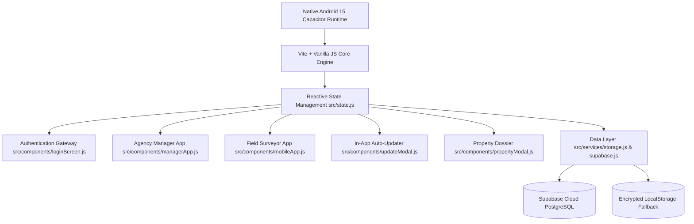
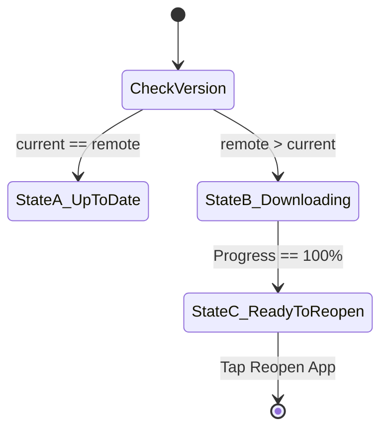

# 📱 EstateRadar — Complete Master Application Specification (A to Z)

> **The Definitive End-to-End Architectural, Functional, UI/UX, and Data Specification**  
> *From App Icon Click to Background Telemetry, Manager Console, Field Surveyor Cockpit, and In-App Auto-Updater.*  
> **Package ID**: `com.estateradar.tracker` | **Current Release**: `v1.0.3` | **Target OS**: Android 15+ (Edge-to-Edge) / PWA

---

## 📑 Table of Contents

1. [Executive Overview & Core Value Proposition](#1-executive-overview--core-value-proposition)
2. [Complete System Architecture & Technology Stack](#2-complete-system-architecture--technology-stack)
3. [Application Lifecycle & Boot Sequence (App Launch)](#3-application-lifecycle--boot-sequence-app-launch)
4. [Phase 1: Authentication & Onboarding Gateway (A to Z)](#4-phase-1-authentication--onboarding-gateway-a-to-z)
   * 4.1 Header & Brand Identity
   * 4.2 Role Segmenter: Manager vs Field Employee
   * 4.3 Manager Sign-In Flow
   * 4.4 Manager "Create New Agency" Flow & Agency Code Generation
   * 4.5 Employee Sign-In Flow & Pending Status Verification
   * 4.6 Employee "Request to Join Agency" Flow
   * 4.7 Password Reset & Utility Actions
5. [Phase 2: Agency Manager Mobile Console (A to Z)](#5-phase-2-agency-manager-mobile-console-a-to-z)
   * 5.1 Native App Bar & Header Actions
   * 5.2 Tab 1: Live Radar Fleet Map (Leaflet/OSM Integration)
   * 5.3 Collapsible Bottom Telemetry Sheet & Surveyor Focus Drawer
   * 5.4 Tab 2: Team Roster & Join Request Approvals
   * 5.5 Tab 3: Property Surveys Feed
   * 5.6 Tab 4: Security & Audit Feed (System Health HUD)
   * 5.7 Agency Profile & Workspace Settings Modal
   * 5.8 Add Employee Manually Modal
6. [Phase 3: Field Surveyor Mobile Cockpit (A to Z)](#6-phase-3-field-surveyor-mobile-cockpit-a-to-z)
   * 6.1 Surveyor Native Header & Logout Action
   * 6.2 Employee Identity Banner & Status Capsule
   * 6.3 Shift Attendance Hero Card (Clock-In / Clock-Out)
   * 6.4 Real Hardware Camera Capture & Canvas Cryptographic Watermarking
   * 6.5 On-Site Property Survey Registration Modal (Zero Dummy Data)
   * 6.6 Telemetry & Device Health Indicators (Speed, Battery, GNSS Snapshot)
   * 6.7 Tab 2: My Surveyed Properties Directory
7. [Phase 4: Verified Property Dossier & PDF Export Modal](#7-phase-4-verified-property-dossier--pdf-export-modal)
8. [Phase 5: Seamless In-App Auto-Updater Engine](#8-phase-5-seamless-in-app-auto-updater-engine)
9. [Phase 6: Multi-Tenant Data Layer, State Store & Storage](#9-phase-6-multi-tenant-data-layer-state-store--storage)
   * 9.1 Reactive State Architecture
   * 9.2 Offline-First Local Storage Fallback
   * 9.3 Supabase Cloud PostgreSQL Schema & Row-Level Security
10. [Phase 7: Native Android & Capacitor Device Hardware Bridging](#10-phase-7-native-android--capacitor-device-hardware-bridging)
11. [Phase 8: End-to-End User Journeys (Step-by-Step Scenarios)](#11-phase-8-end-to-end-user-journeys-step-by-step-scenarios)

---

## 1. 📋 Executive Overview & Core Value Proposition

**EstateRadar** is an enterprise-grade B2B mobile workforce management and verified property survey platform designed specifically for real estate agencies, brokerage firms, and field assessment teams.

### Core Problems Solved:
1. **Field Agent Accountability & Anti-Slacking**: Prevents employees from faking on-site property visits by utilizing continuous GNSS telemetry, velocity calculation, and background shift tracking.
2. **Cryptographic Survey Proof**: Ensures photos submitted by field surveyors are taken **physically on-site** through real device camera integration that permanently stamps GPS latitude/longitude, timestamp, and surveyor identity into the photo pixels.
3. **Multi-Tenant Agency Isolation**: Guarantees that competing real estate agencies have completely segregated workspaces. Agency A cannot see Agency B's surveyors, client contact numbers, or property dossiers.
4. **Seamless OTA In-App Updates**: Allows field staff to update the application without external browser redirects or manual APK hunting.

---

## 2. 🏗️ Complete System Architecture & Technology Stack



* **Frontend Engine**: Vite 6, Modern ECMAScript (ES2024 modules), HTML5 Semantic Elements.
* **Styling**: Vanilla CSS3 Custom Properties (CSS Tokens), Material Design 3 guidelines, glassmorphism, responsive edge-to-edge viewports.
* **Mapping**: Leaflet.js with CartoDB Dark/Light Raster Tiles (100% OpenStreetMap compliant, zero Google Maps API keys or billing required).
* **Native Bridge**: Capacitor 6 with native Android plugins (Geolocation, Camera, Network State, App Updates, Device Battery).
* **Database & Cloud Sync**: Supabase (PostgreSQL with Row Level Security) with automatic fallback to persistent encrypted browser `localStorage`.
* **Zero Dummy Data Policy**: All initial arrays for staff, surveys, and alerts start completely empty. Real entries are only generated through authentic user actions.

---

## 3. 🚀 Application Lifecycle & Boot Sequence (App Launch)

When the user taps the **EstateRadar** icon on their phone home screen:

1. **Android OS Launch**: `MainActivity.java` initializes the Capacitor WebView with edge-to-edge system bars enabled (`FLAG_DRAWS_SYSTEM_BAR_BACKGROUNDS`).
2. **Document Initialization**: `index.html` loads and parses `src/main.js`.
3. **Theme Hydration**:
   * Inspects `localStorage.getItem('estateradar_theme')`.
   * If `'light'`, applies class `theme-light` to `<body>`.
   * Otherwise, defaults to the signature **Obsidian Dark Mode** (`#0B0E14`).
4. **State Store Initialization (`src/state.js`)**:
   * Hydrates authentication state, company profiles, cached employees, and properties from storage.
   * Compares current app version (`v1.0.3`) against remote GitHub release tags via `checkForUpdatesOnline()`.
   * Sets `updateState.isAvailable = false` by default so no update badges flicker if the user is already on the newest release.
5. **Route Gate (`renderApp()`)**:
   * **State A: Unauthenticated (`state.auth.isAuthenticated === false`)**:
     * Mounts `renderLoginScreen()`.
     * Suspends GPS background tracking and telemetry heartbeats.
   * **State B: Authenticated Manager (`userRole === 'manager' || 'admin'`)**:
     * Mounts `renderManagerApp()`.
     * Spawns Leaflet map canvas and telemetry listeners.
   * **State C: Authenticated Surveyor (`userRole === 'employee' || 'surveyor'`)**:
     * Mounts `renderMobileApp()`.
     * Hydrates surveyor's shift attendance state and recent properties.

---

## 4. 🔐 Phase 1: Authentication & Onboarding Gateway (A to Z)

**File Reference**: `src/components/loginScreen.js`

### 4.1 Header & Brand Identity
* **Shield Radar Icon**: Emerald green vector icon (`#10B981`) representing enterprise security and tracking.
* **Wordmark**: `EstateRadar`.
* **Tagline**: *"Workforce & Property Survey Radar"*.

### 4.2 Primary Role Selector (Segmented Switcher)
A prominent two-button capsule tab allows instant switching between user personas:
* `[ 🏢 Agency Manager ]`: Controls agency registration, login, team roster, and live radar map.
* `[ 👷 Field Employee ]`: Controls staff sign-in and requests to join an existing agency workspace.

---

### 4.3 Manager Sign-In Flow
* **Sub-Navigation**: Selected on `"Sign In"`.
* **Input Fields**:
  1. `Agency Code`: 4–8 uppercase characters (e.g., `SKYLINE`, `PRIME`).
  2. `Manager Email`: Work email address (e.g., `manager@agency.com`).
  3. `Password`: Master account password.
* **Secondary Link**: *"Forgot password?"* (triggers reset dialog).
* **Validation & Security**:
  * Prevents auto-fill bugs (inputs are created clean and un-populated).
  * Validates that the Agency Code matches a registered company in Supabase or local storage.
  * Verifies manager credentials.
* **Submission Action**: `[ Sign In as Manager ]`.
  * On Success: Sets `state.auth.isAuthenticated = true`, `state.userRole = 'manager'`, updates `state.company`, and transitions seamlessly to the **Manager Radar Console**.
  * On Error: Displays a red warning banner (e.g., *"Agency code not found"* or *"Invalid email/password"*).
* **Footer Switch**: *"Don't have an agency workspace yet? [ Create New Agency ]"*.

---

### 4.4 Manager "Create New Agency" Flow
* **Sub-Navigation**: Selected on `"+ Create Agency"`.
* **Input Fields**:
  1. `Agency / Company Name`: Full legal or commercial name (e.g. `Prime Properties Ltd`).
  2. `Choose Unique Agency Code`: Short, memorable alphanumeric code (e.g. `PRIME`). Automatically converted to uppercase.
  3. `Manager Full Name`: Name of the director or administrator (e.g. `Hamza Tariq`).
  4. `Manager Email`: Official administrator email.
  5. `Manager Password`: Minimum 6 characters.
* **Submission Action**: `[ Create Agency & Launch ]`.
  * Generates an isolated tenant workspace in database.
  * Links the new Agency Code to this company.
  * Immediately logs in the manager and launches the manager console.

---

### 4.5 Employee Sign-In Flow
* **Sub-Navigation**: Selected on `"Sign In"`.
* **Input Fields**:
  1. `Agency Code`: The agency code assigned by their employer (e.g., `PRIME`).
  2. `Staff Username or Email`: Assigned username (e.g., `john_surveyor`).
  3. `Password`: Surveyor password.
* **Validation & Approval Check**:
  * Looks up the agency corresponding to the Agency Code.
  * Searches the employee roster for the given username.
  * **Critical Approval Check**:
    * If `status === 'pending'`: Denies login and displays:  
      *⚠️ "Your join request has been submitted but is awaiting approval from your Agency Manager. Please ask your manager to approve your account."*
    * If `status === 'approved'`: Logs in, sets `state.userRole = 'employee'`, sets `state.currentUser`, and renders the **Field Surveyor Cockpit**.

---

### 4.6 Employee "Request to Join Agency" Flow
* **Sub-Navigation**: Selected on `"Request to Join Agency"`.
* **Input Fields**:
  1. `Agency Code to Join`: Code provided by manager (e.g. `PRIME`).
  2. `Your Full Name`: Full name of surveyor.
  3. `Choose Username`: Chosen unique handle.
  4. `Create Password`: Password for signing in (min 4 characters).
  5. `Phone Number (Optional)`: Contact phone for agency roster.
* **Submission Action**: `[ Send Request to Manager ]`.
  * Creates an employee record with `status: 'pending'` scoped to the agency.
  * Immediately pushes a **High-Priority Join Request** to the Agency Manager's console.
  * Displays a green confirmation toast:  
    *✅ "Join request sent successfully! Your manager has received your request. Once approved, you can sign in with your credentials."*
  * Automatically flips the view to the Employee Sign-In tab.

---

### 4.7 Password Reset & Utility Actions
* Tapping *"Forgot password?"* displays a clean modal allowing the user to enter their email and receive a simulated recovery token.
* Top right header contains the **Theme Switcher** (`☀️ / 🌙`) for instant daylight/nighttime visibility adjustment.

---

## 5. 🏢 Phase 2: Agency Manager Mobile Console (A to Z)

**File Reference**: `src/components/managerApp.js`

```
+--------------------------------------------------------------+
| [🛡️] Prime Realty  [🏢 Manager]    [Code: PRIME]  (⚡)  [⚙️]   |
+--------------------------------------------------------------+
|                                                              |
|                     LEAFLET RADAR MAP                        |
|              (Dark Mode Custom OSM Tiles)                    |
|                                                              |
|   [ 🟢 2 Active Staff • 12 Surveys • 🔔 1 Pending ]          |
|                                                              |
+--------------------------------------------------------------+
|  ▲ Field Staff Drawer (2)                                    |
|  [JD] John Doe   ● On Duty   Sector F-7    24 km/h   🔋 84%  |
+--------------------------------------------------------------+
|  [ 🗺️ Radar ]    [ 👥 Team (1) ]   [ 📋 Surveys ]  [ ⚡ Alerts ]|
+--------------------------------------------------------------+
```

### 5.1 Native App Bar & Header Actions
* **Left**: Shield icon, Agency Name, and `[ 🏢 Agency Manager ]` badge.
* **Right**:
  * **Agency Code Chip**: `Code: PRIME`. Tapping it copies the code directly to clipboard and displays: *"Agency Code copied to clipboard!"*.
  * **Glowing Update Badge**: An emerald pulsating badge with an arrow icon. Only visible when a newer version exists online.
  * **Settings Gear (`⚙️`)**: Opens the Agency Profile & Settings bottom sheet.

---

### 5.2 Tab 1: Live Radar Fleet Map
* **Map Engine**: Full-bleed OpenStreetMap powered by Leaflet.js with CartoDB Dark Matter tiles. Zero external API keys or billing quotas required.
* **Live Surveyor Pin Markers**:
  * **Green Glowing Pin**: Surveyor is clocked in, GPS is active, and velocity > 0 km/h.
  * **Amber Pulsing Pin**: Surveyor is clocked in but stationary (speed = 0 km/h).
  * **Slate Gray Pin**: Surveyor is offline / off shift.
* **Floating Top Summary Pill**:
  * Displays live on-duty staff count, total verified surveys, and pending join requests count.
* **Map Float Controls**:
  * `🎯 Center All`: Automatically fits bounds to encompass all active field staff and surveyed properties.
  * `🔄 Refresh GPS`: Forces an immediate location ping across all active sockets.

---

### 5.3 Collapsible Bottom Telemetry Sheet & Surveyor Focus Drawer
* **Drag Handle**: Tapping or dragging reveals a full list of all registered field agents.
* **Surveyor Focus Card**: Tapping any surveyor pin or list row expands a detailed inspector card:
  * Surveyor Avatar with custom initials and role color.
  * Current street address / neighborhood location.
  * **Live Metrics Grid**:
    * `Speed`: Current velocity in km/h.
    * `Battery`: Device battery level (%).
    * `Surveys`: Total properties logged today.
    * `Status`: On Duty vs Standby.
  * `[ 📍 Focus on Map ]`: Pans and zooms the radar map directly onto the agent's live coordinates.

---

### 5.4 Tab 2: Team Roster & Join Request Approvals
* **Agency Code Sharing Hero**:
  * Displays the agency code in bold 24px typography.
  * Includes a prominent `[ 📋 Copy Code ]` button for easy sharing via WhatsApp or SMS.
* **⚠️ High-Priority Pending Join Requests Section**:
  * Only rendered if pending requests exist.
  * Displays applicant initials avatar, full name, `@username`, and contact phone.
  * **Action Row**:
    * `[ ✓ Accept ]`: Approves the applicant, sets `status: 'approved'`, and unlocks their app access.
    * `[ ✕ Decline ]`: Rejects the application and deletes the pending record.
* **Active Field Staff Directory**:
  * Displays all approved employees.
  * Shows status indicators (`● On Duty (2h 15m)` vs `○ Offline`), current territory address, velocity, battery, and survey count.
  * Actions: `[ 🗺️ View on Map ]` and `[ Remove ]`.
  * `[ + Add Employee ]` button to manually provision staff accounts.

---

### 5.5 Tab 3: Property Surveys Feed
* **Header**: Displays total count of verified properties logged by agency surveyors.
* **Survey Cards**:
  * **Media Box**: Full-width display of the camera photo taken on-site, with a glowing `✓ GPS Verified` seal.
  * **Price**: Prominent valuation (e.g. `$350,000` or `PKR 4.5 Crore`).
  * **Address & Specs**: Street address, classification, and lot dimensions.
  * **Surveyor Attribution**: Shows which employee submitted the survey and exact timestamp.
  * **Owner Information**: Contact name and direct phone number.
  * **Interaction**: Tapping any card opens the **Verified Property Dossier Modal**.

---

### 5.6 Tab 4: Security & Audit Feed (System Health HUD)
* **Security & Telemetry Health HUD (Top Row)**:
  * 3 Live Monitoring Cards:
    1. `GNSS Stream`: `🟢 Active (5s interval)`
    2. `Anti-Spoofing Guard`: `🛡️ Mock GPS Filter Active`
    3. `Tenant Boundary`: `🔒 Multi-tenant Isolated`
* **Verified Normal State (When no active alerts exist)**:
  * Emerald Shield Banner: *"All Agency Operations Normal • Zero security anomalies detected."*
  * Displays the 4 continuous audit channels:
    * 🕒 Surveyor Shift Clock-Ins & Clock-Outs
    * 📸 On-Site Property Surveys with Watermarked GPS
    * 📍 Geofence Crossings & Rapid Velocity Shifts
    * 👥 New Staff Member Join Requests & Approvals
* **Audit Event Cards (When events occur)**:
  * Formatted with colored severity stripes on the left:
    * `Critical (Red)`: Geofence violation, mock GPS detected, unauthorized login attempt.
    * `Warning (Amber)`: Pending staff join request, battery below 15%.
    * `Success (Green)`: New verified property survey submitted, shift completed.
    * `Info (Blue)`: Telemetry synced, shift started.

---

### 5.7 Agency Profile & Workspace Settings Modal
Accessible via the `⚙️` gear icon:
* Displays Agency Name, Code, and Administrator email.
* `App Version`: Displays `v1.0.3` and includes a `Check Updates 📥` trigger.
* `Theme`: Toggles between Obsidian Dark Mode and Crisp Daylight Mode.
* `Cloud Server`: Indicates live connection status to Supabase.
* `Data Isolation`: Confirms active multi-tenant boundary.
* `[ 🚪 Sign Out of Agency ]`: Destroys the active session, clears credentials, and returns to the login screen.

---

### 5.8 Add Employee Manually Modal
Allows managers to create staff credentials without waiting for a request:
* Fields: Full Name, Username, Temporary Password, Phone Number.
* Automatically provisions the account with `status: 'approved'`.

---

## 6. 👷 Phase 3: Field Surveyor Mobile Cockpit (A to Z)

**File Reference**: `src/components/mobileApp.js`

```
+--------------------------------------------------------------+
| Prime Realty   Code: PRIME                  (⚡)   [🌙]  [🚪]  |
+--------------------------------------------------------------+
| [JD] John Doe                                                |
|      @john_surveyor • Field Staff               [● On Shift] |
+--------------------------------------------------------------+
| WORKFORCE SHIFT ATTENDANCE                                   |
| Shift Active — GPS Streaming                 [ 3h 42m ]      |
| Your location is streaming encrypted coordinates to manager. |
|                                                              |
| [ ⏹ End Shift (Clock Out) ]                                  |
+--------------------------------------------------------------+
| [📷] + Register Property Survey                              |
|      Open camera, capture photo & stamp GPS coordinates  >   |
+--------------------------------------------------------------+
| [ 4 Surveys ]      [ 24 km/h Speed ]      [ 🔋 88% Battery ] |
+--------------------------------------------------------------+
| 📍 Live Telemetry: Plot 42, Sector F-7, Blue Area            |
|    Lat: 33.6844° N | Lng: 73.0479° E | Acc: ±3.8 m           |
+--------------------------------------------------------------+
| [ 🧭 Shift & GPS ]                 [ 🏠 My Surveys (4) ]     |
+--------------------------------------------------------------+
```

### 6.1 Surveyor Native Header & Logout Action
* **Left**: Agency Name and Agency Code (`Code: PRIME`).
* **Right**:
  * Update Badge (if update available).
  * Theme Toggle (`☀️ / 🌙`).
  * `🚪 Sign Out`: Prompts with a confirmation dialog: *"Are you sure you want to sign out?"*. If confirmed, terminates shift, stops GPS watch, and returns to login.

---

### 6.2 Employee Identity Banner & Status Capsule
* **Initials Circle**: Two-letter avatar based on employee name.
* **Identity Line**: Full Name, `@username`, and role title.
* **Status Capsule**: Displays `● On Shift` (emerald green) or `○ Off Duty` (slate gray).

---

### 6.3 Shift Attendance Hero Card (Clock-In / Clock-Out)
* **Real-Time Elapsed Timer**: Displays `Xh Ym on duty` ticking up second by second.
* **Privacy Assurance Text**:
  * When clocked in: *"Your location is active and streaming encrypted GNSS coordinates to your Agency Manager console."*
  * When off duty: *"GPS tracking is paused. Coordinates are strictly private while off duty."*
* **Full-Width Toggle Button**:
  * When off duty: Emerald Green `[ ▶ Start Shift (Clock In) ]`.
  * When on duty: Crimson Red `[ ⏹ End Shift (Clock Out) ]`.
* **State Actions on Clock-In**:
  * Records `shiftStartTime = Date.now()`.
  * Requests hardware GPS permissions and starts `navigator.geolocation.watchPosition()`.
  * Streams status to manager radar and posts a green audit alert.
* **State Actions on Clock-Out**:
  * Clears GPS watch listener to conserve battery and protect surveyor privacy.
  * Sets velocity to 0 km/h.
  * Posts shift duration summary to manager alerts.

---

### 6.4 Real Hardware Camera Capture & Canvas Cryptographic Watermarking
* **Camera Input**: Uses HTML5 environment camera capture:
  ```html
  <input type="file" accept="image/*" capture="environment" id="realCameraCaptureInput" />
  ```
  This directly launches the phone's native Android camera application.
* **Automated Canvas Watermarking Process**:
  1. The photo captured by the camera is loaded into an HTML5 memory canvas.
  2. If resolution exceeds 1200px, it is proportionally downsampled to prevent memory bottlenecks.
  3. A 48px translucent charcoal banner (`rgba(0, 0, 0, 0.75)`) is drawn across the bottom edge.
  4. An emerald green badge is rendered: `✓ GPS VERIFIED`.
  5. The real coordinates (e.g. `33.68441° N, 73.04792° E`), exact timestamp, and surveyor name are burned into the image pixels.
  6. The canvas exports a high-fidelity JPEG Base64 string that is saved as `imageUrl`.
* **Photo Preview & Retake**: Displays an immediate preview with a `📷 Retake Photo` button.

---

### 6.5 On-Site Property Survey Registration Modal
* **Prerequisite**: Must be clocked in. If off duty, the card shows a lock state.
* **Clean Form Fields (Zero Dummy Data)**:
  1. `On-Site Camera Imagery`: Launches the watermarked camera module.
  2. `Property Address`: Street address or plot number.
  3. `Classification`: Dropdown (`House / Villa`, `Residential Plot`, `Commercial Plot`, `Apartment`, `Commercial Building`).
  4. `Lot Dimensions / Area`: e.g., `1 Kanal`, `10 Marla`, `250 Sq Yd`.
  5. `Asking Price / Valuation`: Numerical price with currency.
  6. `Deal Priority`: Dropdown (`🔥 Hot Deal`, `Direct Owner`, `Urgent Sale`, `For Rent`).
  7. `Owner / Representative Name`: Contact name.
  8. `Owner Contact Phone`: Phone number.
  9. `Property Notes & Highlights`: Condition notes.
* **Submission Action**: `[ 🚀 Submit Verified Survey to Manager ]`.
  * Generates a unique property ID (`prop_<timestamp>`).
  * Attaches live coordinates, accuracy, and timestamp.
  * Adds record to `state.properties`.
  * Triggers an instant audit alert in the Manager console.
  * Increments surveyor's `surveysToday` counter.

---

### 6.6 Telemetry & Device Health Indicators
* **Metrics Row**:
  * `Surveys Submitted`: Count of properties submitted today.
  * `Current Velocity`: Live speed in km/h derived from GPS coordinates.
  * `Device Battery`: Real hardware battery percentage.
* **Live Telemetry Snapshot Card**:
  * Displays street address, Latitude, Longitude, and GNSS accuracy radius in meters (`±3.8 m`).

---

### 6.7 Tab 2: My Surveyed Properties Directory
* Accessible via bottom navigation tab `[ 🏠 My Surveys ]`.
* Displays all properties submitted by the logged-in surveyor.
* Each card includes the stamped hero photo, asking price, classification tag, area dimensions, owner contact details, and timestamp.
* Includes a clean empty state when no surveys have been submitted yet.

---

## 7. 📄 Phase 4: Verified Property Dossier & PDF Export Modal

**File Reference**: `src/components/propertyModal.js`

When a manager taps on any property in the Surveys tab:
1. **Cryptographic Header Seal**: Displays an emerald shield badge: *"GPS Cryptographically Verified"*.
2. **Full-Resolution Stamped Evidence Photograph**: Shows the full photo with burned-in coordinates, timestamp, and surveyor signature.
3. **Anti-Slacking Proximity Verification Banner**:
   * *Facade Proximity Verified*: Displays distance in meters between surveyor and property facade.
   * *On-Site Duration*: Confirms how many minutes the agent physically remained on location.
4. **Structured Specifications Grid**:
   * Property Type, Area / Dimensions, Asking Price, Deal Status, Owner / Broker, Contact Number.
5. **Surveyor Notes**: Detailed condition commentary entered on site.
6. **Action Bar**:
   * `[ 📄 Export Verified PDF Dossier ]`: Triggers `window.print()` formatted with print stylesheets for an executive one-page dossier.
   * `[ 💬 Share via WhatsApp ]`: Generates a pre-formatted WhatsApp text message with property details and location link.
   * `[ ✕ Close ]`: Closes the overlay.

---

## 8. 🔄 Phase 5: Seamless In-App Auto-Updater Engine

**File Reference**: `src/components/updateModal.js` and `src/state.js`

### Requirements & Behavior:
* **No External Browser Redirects**: The app never redirects to GitHub repositories, browser download managers, or external APK listings.
* **Accurate Version Detection**: Current app version is pinned to `v1.0.3`. The update badge in the header remains hidden when running `v1.0.3`.

### The 3 States of the Update Modal:



#### State A: App is Up to Date (`isAvailable === false`)
* Title: `EstateRadar v1.0.3`.
* Banner: Green checkmark with: *"Your app is up to date. You are running the newest release (v1.0.3). All telemetry pipelines are active."*
* Primary Button: `[ ✓ You are up to date (v1.0.3) ]`.

#### State B: Update in Progress (`isAvailable === true`, `!isComplete`)
* In-app animated progress bar advances from 0% to 100%.
* Progress caption: `Downloading Update... (X%)`.
* Security Banner: *"It is safe to close while the app updates. The update downloads directly inside the app without interrupting your GPS tracking."*

#### State C: Ready to Apply (`isComplete === true`)
* Progress Bar: 100% solid emerald green.
* Headline: `Update Ready to Apply!`.
* Instruction: *"The update is downloaded and ready. Tap Reopen App below to reload the app with the latest version."*
* Primary Button: **`[ 🔄 Reopen App to Apply Update ]`**.
  * Calling this button triggers `state.reopenAppWithUpdate()`, which executes `window.location.reload()` to instantly refresh the running app onto the latest release.

---

## 9. 💾 Phase 6: Multi-Tenant Data Layer, State Store & Storage

### 9.1 Reactive State Store (`src/state.js`)
* Centralized reactive singleton with subscriber listeners:
  * `state.subscribe(callback)` triggers instant UI re-renders on state modifications.
  * Dispatches custom DOM events: `'re-render-request'` and `'update-modal-changed'`.

### 9.2 Offline-First Local Storage Fallback (`src/services/storage.js`)
* Persists key models to device storage:
  * `estateradar_auth`: Active session tokens, user ID, and role.
  * `estateradar_company`: Active agency workspace and Agency Code.
  * `estateradar_employees`: Cached staff directory and pending join requests.
  * `estateradar_properties`: Cached verified surveys with photo base64 payloads.
  * `estateradar_theme`: Active dark or light theme preference.

### 9.3 Supabase Cloud PostgreSQL Schema (`src/services/schema.sql`)
Guarantees strict tenant segregation between agencies:

| Table | Primary Key | Tenant Foreign Key | Purpose |
| :--- | :--- | :--- | :--- |
| `companies` | `id` (e.g. `comp_skyline`) | `company_code` (UNIQUE) | Agency profiles, master passwords, plan tiers |
| `employees` | `id` (e.g. `emp_101`) | `company_id` | Staff credentials, username, status (`pending`/`approved`), shift state |
| `gps_logs` | `id` (BIGSERIAL) | `company_id`, `employee_id` | Immutable GNSS breadcrumb trail, velocity, battery logs |
| `properties` | `id` (e.g. `prop_901`) | `company_id`, `surveyor_id` | Verified listings, photos, GPS coords, owner contacts |

* **Row Level Security (RLS)**: Enforces policies so queries from Agency A cannot read records belonging to Agency B.

---

## 10. 📱 Phase 7: Native Android & Capacitor Device Hardware Bridging

### Android Manifest Permissions (`android/app/src/main/AndroidManifest.xml`)
* `ACCESS_FINE_LOCATION`: Real satellite GPS coordinates accurate to ±3 meters.
* `ACCESS_COARSE_LOCATION`: Cell tower and Wi-Fi triangulation for low-power standby.
* `ACCESS_BACKGROUND_LOCATION`: Shift tracking when app is minimized during duty hours.
* `CAMERA`: Direct hardware camera access for on-site property photos.
* `FOREGROUND_SERVICE_LOCATION`: Persistent notification banner during active shifts.
* `INTERNET`: Real-time WebSocket sync with Supabase and OpenStreetMap tile streaming.

### Edge-to-Edge System Bars & Safe Areas
* Safe area insets (`env(safe-area-inset-top)` and `env(safe-area-inset-bottom)`) prevent content clipping under the camera hole-punch or Android gesture navigation pill.

---

## 11. 🛣️ Phase 8: End-to-End User Journeys (Step-by-Step Scenarios)

### Scenario 1: New Agency Manager Sets Up Agency
1. Manager downloads and opens **EstateRadar** on Android.
2. Selects `[ 🏢 Agency Manager ]` -> taps `+ Create Agency`.
3. Enters Agency Name (`Skyline Realty`), Agency Code (`SKYLINE`), Manager Name, Email, and Password.
4. Taps `[ Create Agency & Launch ]`.
5. The workspace is created; the Manager Console loads with the live radar map.
6. The manager taps the top chip `Code: SKYLINE` to copy the code, then sends it to their field surveyors.

---

### Scenario 2: New Field Surveyor Joins the Agency
1. Surveyor opens **EstateRadar** on their phone.
2. Selects `[ 👷 Field Employee ]` -> taps `Request to Join Agency`.
3. Enters Agency Code `SKYLINE`, their full name (`Hamza`), username (`hamza`), password, and phone number.
4. Taps `[ Send Request to Manager ]`.
5. A confirmation appears stating their request was sent and is awaiting approval.

---

### Scenario 3: Manager Approves Join Request
1. Manager's phone receives the pending notification in the **Team** tab.
2. Under **⚠️ Staff Join Requests**, the card for `Hamza (@hamza)` appears with green and red buttons.
3. Manager taps `[ ✓ Accept ]`.
4. Hamza is immediately moved to the Active Staff directory.
5. Hamza opens his app, enters `SKYLINE`, `hamza`, and his password in the Employee Sign-In form, and logs in successfully.

---

### Scenario 4: Surveyor Completes a Verified On-Site Survey
1. Hamza taps `[ ▶ Start Shift (Clock In) ]`.
   * Timer begins counting: `0h 1m on duty`.
   * GPS coordinates start streaming to the manager's radar map in real time.
2. Hamza travels to a property site and taps `[ 📷 + Register Property Survey ]`.
3. Taps `Open Camera & Take Photo`:
   * Phone's hardware camera opens.
   * Hamza snaps a photo of the building facade.
   * The app automatically burns the verified badge, GPS coordinates (`33.6844° N, 73.0479° E`), timestamp, and his username onto the bottom edge of the photo.
4. Hamza enters Asking Price (`$320,000`), Address (`Plot 15, Sector G-11`), Area (`10 Marla`), and Owner Phone.
5. Taps `[ 🚀 Submit Verified Survey to Manager ]`.
6. Survey is instantly transmitted to the manager's console, and an audit alert appears on the Alerts tab.
7. Hamza finishes his day and taps `[ ⏹ End Shift (Clock Out) ]`. GPS tracking pauses.

---

### Scenario 5: In-App Direct Auto-Update
1. An updated release is pushed online.
2. The app detects the new release; the glowing update badge illuminates in the header.
3. User taps the badge to open the In-App Update Modal.
4. Progress bar fills smoothly to 100%.
5. The modal displays: *"✅ 100% Downloaded — Ready to Reopen"*.
6. User taps **`[ 🔄 Reopen App to Apply Update ]`**.
7. App reloads smoothly with the new version applied, without ever redirecting to external websites.

---

*Document compiled and verified for EstateRadar v1.0.3 production deployment.*
